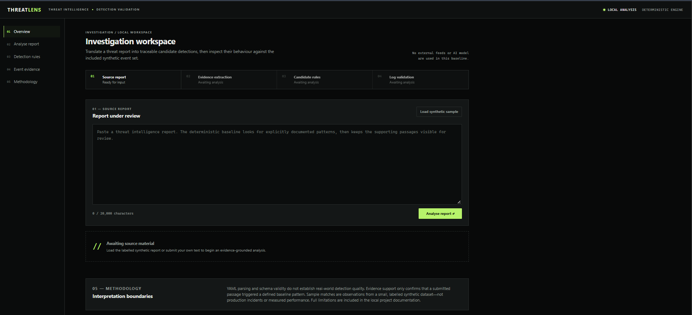
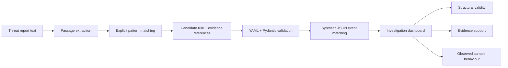

# THREATLENS

### From threat intelligence to evidence-backed detection.

A local, evidence-grounded threat-intelligence workstation that turns explicitly reported behaviours into traceable candidate detections, validates their structure, and checks their behaviour against labelled synthetic events.

  
  
  

  
  
  
  
  

> [!IMPORTANT]
> ThreatLens is a transparent deterministic baseline, not an LLM or autonomous AI agent. It does not access production systems, external intelligence feeds, credentials, or real security logs.

## Overview

Threat reports often describe behaviour in prose, while detections must be auditable technical artifacts. ThreatLens narrows that gap: it keeps supporting passages visible beside each candidate rule, validates a deliberately small YAML rule schema, and displays suspicious and benign sample matches separately.

| Question | ThreatLens answer |
|---|---|
| Is the rule structurally valid? | YAML is parsed with PyYAML and validated with Pydantic. |
| Is the rule supported by this report? | Literal evidence passages are attached, or the candidate is marked unsupported. |
| How did it behave on the sample set? | Matching suspicious and benign synthetic event IDs are shown independently. |

## ✦ Key features

| Capability | What is implemented |
|---|---|
| Evidence extraction | Case-insensitive passage extraction for explicit report terms, with stable <code>passage-N</code> references. |
| Candidate rules | Two intentionally narrow baselines: <code>rundll32.exe</code> process execution and <code>powershell -enc</code> command-line use. |
| Rule inspection | Candidate status, evidence status, schema status, YAML, matched-event counts, and supporting passages. |
| Custom rule schema | ANDed <code>equals</code> and <code>contains</code> conditions for documented event fields; this is <strong>not</strong> a complete Sigma implementation. |
| Event validation | Structured JSON events are validated and unexpected fields are rejected. |
| Benign-match visibility | Benign synthetic matches are surfaced as potential false-positive warnings. |
| Reproducible evaluation | Independent expected-rule labels yield confusion-matrix counts, precision, recall, and false-positive rate. |
| Local workstation UI | A same-origin FastAPI dashboard with report input, rule inspection, event evidence, loading/error states, and accessible controls. |

## Product preview

The dashboard is a near-black analyst workstation with an investigation workflow, evidence pane, rule inspector, YAML view, and synthetic-event table.

No screenshot is committed yet. To add a genuine preview, run the app, load the synthetic report, capture the browser window, save it as <code>docs/images/threatlens-dashboard.png</code>, then add:

~~~md

~~~

Only use a screenshot containing the bundled synthetic report and events.

## How it works

| Report literal | Candidate ID | Detection condition |
|---|---|---|
| <code>rundll32.exe</code> | <code>tl-rundll32-execution</code> | <code>process_name equals rundll32.exe</code> |
| <code>powershell -enc</code> | <code>tl-encoded-powershell</code> | <code>command_line contains powershell -enc</code> |

## Technology stack

| Layer | Technologies |
|---|---|
| Interface | HTML, CSS, vanilla JavaScript |
| Web service | FastAPI, Uvicorn |
| Models & validation | Pydantic |
| YAML | PyYAML |
| Tests | pytest, FastAPI TestClient, httpx |
| Data | Local JSON and text files only |

## Quick start

### Windows PowerShell

~~~powershell
git clone https://github.com/shashank3115/ThreatLens.git
cd ThreatLens
python -m venv .venv
.\.venv\Scripts\Activate.ps1
python -m pip install -r requirements.txt
python -m uvicorn app.main:app --reload
~~~

Open [http://127.0.0.1:8000](http://127.0.0.1:8000). Interactive API documentation is available at [http://127.0.0.1:8000/docs](http://127.0.0.1:8000/docs).

If PowerShell execution policy blocks activation, skip that line and call the virtual-environment interpreter directly:

~~~powershell
.\.venv\Scripts\python.exe -m pip install -r requirements.txt
.\.venv\Scripts\python.exe -m uvicorn app.main:app --reload
~~~

### Linux / macOS

~~~bash
git clone https://github.com/shashank3115/ThreatLens.git
cd ThreatLens
python3 -m venv .venv
source .venv/bin/activate
python -m pip install -r requirements.txt
python -m uvicorn app.main:app --reload
~~~

### Run the tests

~~~powershell
.\.venv\Scripts\python.exe -m pytest -q
~~~

~~~bash
python -m pytest -q
~~~

## Project structure

~~~text
ThreatLens/
├── app/
│   ├── main.py           # FastAPI routes and static-file hosting
│   ├── service.py        # Analysis orchestration and sample-data loading
│   ├── evidence.py       # Passage extraction
│   ├── rules.py          # Explicit candidate-rule patterns and YAML rendering
│   ├── validator.py      # YAML/schema validation
│   ├── log_matcher.py    # Deterministic event matching
│   ├── evaluation.py     # Synthetic evaluation metrics
│   └── models.py         # Pydantic request, rule, and event models
├── data/
│   ├── sample_report.txt
│   ├── sample_logs.json
│   └── evaluation_cases.json
├── static/               # Same-origin workstation frontend
├── tests/                # Unit and API regression tests
├── docs/
│   ├── architecture.md
│   └── limitations.md
├── render.yaml           # Optional stateless Render service definition
└── requirements.txt
~~~

## Example workflow

1. Start the app and select **Load synthetic sample**.
2. Select **Analyse report**.
3. Review the extracted passages and their <code>passage-N</code> references.
4. Open each candidate rule to inspect its YAML, schema status, and evidence support.
5. Compare suspicious sample matches with benign sample matches in the event-evidence table.
6. Treat a benign match as a warning for analyst review—not as a production false-positive measurement.

### API surface

| Endpoint | Purpose |
|---|---|
| <code>GET /api/health</code> | Hosting-ready health check that verifies bundled sample data is available. |
| <code>GET /api/sample-report</code> | Returns the safe, fictional demonstration report. |
| <code>GET /api/sample-events</code> | Returns the labelled synthetic event data shown by the interface. |
| <code>GET /api/evaluation</code> | Returns metrics from the documented synthetic evaluation dataset. |
| <code>POST /api/analyze</code> | Analyses <code>{ "report": "..." }</code> in memory; reports are not persisted or logged. |

<strong>Example analysis request</strong>

~~~bash
curl -X POST http://127.0.0.1:8000/api/analyze \
  -H "Content-Type: application/json" \
  -d '{"report":"The operator used rundll32.exe and powershell -enc."}'
~~~

The response contains candidate rules, YAML, structural-validation results, evidence references, suspicious event IDs, benign event IDs, and any false-positive warning.

## Evaluation & interpretation

The bundled evaluation dataset contains six hand-authored synthetic cases: two intended detections, two benign lookalikes, and two unrelated events. Its expected rule IDs are stored independently from the matcher.

| Per baseline rule | Result on bundled synthetic data |
|---|---:|
| True positives / false positives / true negatives / false negatives | 1 / 1 / 4 / 0 |
| Precision | 0.5 |
| Recall | 1.0 |
| False-positive rate | 0.2 |

These values are calculated from <code>data/evaluation_cases.json</code>; they are not claims about production security data. A zero denominator is represented as <code>null</code> rather than an invented value.

For deeper details, see [architecture](docs/architecture.md) and [limitations](docs/limitations.md).

## Research inspiration

ThreatLens is a small research-inspired prototype for evidence-grounded detection engineering. Its emphasis on preserving links between threat-report evidence and candidate detections aligns with the broader research interest in grounding CTI-derived rules. It is <strong>not</strong> a reproduction of CTI-REALM, does not claim equivalent datasets or benchmarks, and should not be compared as such.

## Roadmap

- [x] Local FastAPI service and same-origin dashboard
- [x] Deterministic evidence extraction and candidate rules
- [x] YAML/schema validation and synthetic log matching
- [x] Benign-match warnings and reproducible synthetic evaluation
- [x] Stateless Render deployment configuration
- [ ] More documented rule patterns and field-specific constraints
- [ ] Rule editing with validation feedback
- [ ] Larger, versioned synthetic evaluation datasets
- [ ] Optional AI-assisted extraction with transparent provenance and evaluation

## Responsible use

ThreatLens is designed for learning, demonstration, and controlled evaluation. Use only synthetic or authorised data. Do not upload credentials, confidential reports, production logs, or personal information. A parsed rule, supporting text, or a sample match does not establish that a real system is compromised or that a detection is production-ready; analyst review and environment-specific validation remain essential.

## Author

Built by [Shashank Padmasali](https://github.com/shashank3115) for TCS Xplore Zeta Innovate.

- GitHub: [@shashank3115](https://github.com/shashank3115)
- LinkedIn: [shashank-padmasali](https://www.linkedin.com/in/shashank-padmasali)

## License

No license has been specified for this repository.
